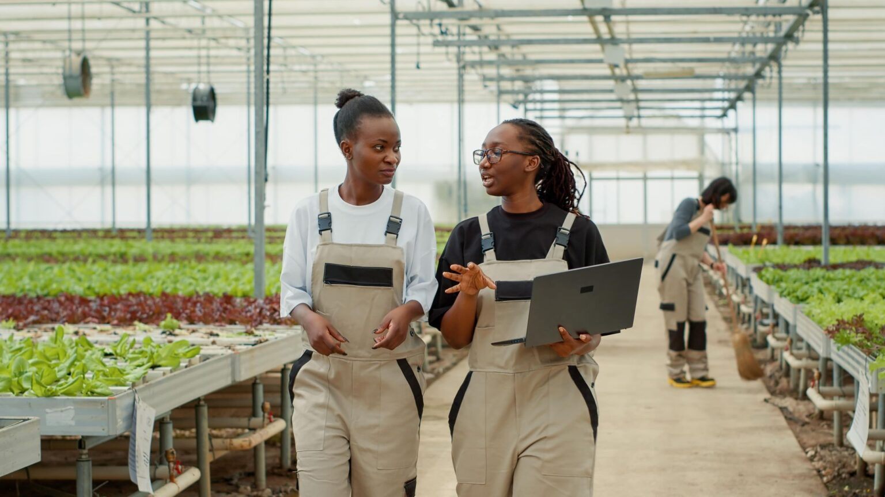

October 2026

<h1 class="cover-org">Trafigura Foundation</h1>

Digital Performance Report

<strong>Reporting period</strong> · October 2026

<strong>Prepared for</strong> · Trafigura Foundation

<strong>Report date</strong> · 2 November 2026

Made By UNE

<!-- 00 Goal -->

00

Goal of this report

This monthly report tells the story of how trafigurafoundation.org performed in October — and what we did to strengthen it.

We focus on four questions:

<ul>
<li><strong>What did we deliver?</strong> — the work completed on the site</li>
<li><strong>What went live?</strong> — new stories and pages published</li>
<li><strong>How did people respond?</strong> — search visibility, visits, and how the Foundation appears in AI answers</li>
<li><strong>What comes next?</strong> — priorities for November</li>
</ul>

October was a <strong>mixed month</strong>. Fewer people arrived from Google, but total visits still grew, and searches that do not use the Foundation’s name brought more visits than in September. On the site, we made Who We Are much faster on phones and fixed how the launch film appears on Our Approach.

<!-- 01 Work completed -->

01

Work completed

Delivery · October 2026

Site performance & technical SEO

<ul>
<li>Who We Are on phones: lab score up from <strong>76 to 97</strong>, and the main image now appears in <strong>2.5 seconds</strong> instead of 3.8</li>
<li>Our Approach: the banner now loads straight away and phones get a smaller file. Phone speed has not improved yet, so this continues in November</li>
<li>Our Approach launch film now shows a cover image at full size, instead of a thin black strip, and only downloads when someone presses play</li>
<li>Clearer link text on Our Approach, replacing a generic “Learn more”</li>
</ul>

Structure & content

<ul>
<li>Staff Engagement: the new staff map animation plays once as it scrolls into view</li>
<li>Content Hub: “Video” added to the category filter, so videos can be found alongside news and publications</li>
<li>Pages that should stay out of Google rechecked: utility pages and Tales of Resilience are still hidden from search</li>
</ul>

i

The speed work on Who We Are is the clearest win: it is the second most visited page from Google, and on a phone it now loads almost as quickly as the homepage. One task from last month’s plan did not land: the newest stories still carry the generic description in Google. That list is now seven pages long, and it is the first job for November.

<!-- 02 Content published -->

02

Content published

News & partner stories · October 2026

Two news stories and two partner stories went into the public sitemap. Six existing partner stories were also updated on 15 October.

<h3>News</h3>

| Story |
|---|
| Our Partner Forum at New York Climate Week |
| New Impact Investments for Climate Resilience in Africa and Small Island States |

<h3>Partner stories</h3>

| Partner |
|---|
| Outrigger |
| Catalyst Fund |

<strong>Sitemap:</strong> 123 pages in total (9 core pages · 3 area pillars · 68 news · 43 partner stories).

What this means

Both news stories link to the partner pages they mention: the impact-investment story links Catalyst Fund and Outrigger, and the Climate Week story links eight partners. That is exactly the link from story to organisation that helps visitors and Google connect the two. The gap is the description: all four new pages, plus three from late September, still use the generic “Established in 2007…” sentence in Google and on social shares.

<!-- 03 Search -->

03

How people find Trafigura Foundation

Google Search Console · October 2026

| Measure | October | Δ vs September | Δ vs Oct 2025 |
|---|---:|---|---|
| Clicks from Google | 701 | −11.0% | −11.2% |
| Times shown in search | 39,600 | −17.6% | −17.6% |
| Click-through rate | 1.8% | +8.0% | +18.4% |
| Average position (lower is better) | 6.7 | −4.6% (better) | −2.8% (better) |

Changes are as reported by Google Search Console against the previous 31 days, so they will not match last month’s totals exactly.

<h3>Top searches</h3>

| Search term | Clicks | What it tells us |
|---|---:|---|
| trafigura foundation | 255 | Core brand — people who already know the name |
| trafigura zambia | 23 | New this month — people looking for the work in Zambia, landing on COMACO |
| james josling | 21 | People looking up Foundation leadership (plus 7 for “james josling trafigura”) |
| fondation trafigura | 19 | French-language brand demand |
| trafigura | 7 | Broad brand name; shown very often, clicked rarely |
| blue catalyst fund | 2 | Partner name bringing search visits |

<h3>Top pages from Google</h3>

| Page | Clicks | Role |
|---|---:|---|
| Homepage | 327 | Main entry — just under half of all search clicks |
| Who We Are | 154 | Strong second page — mission and identity |
| COMACO (partner story) | 22 | New in the top three — Zambia searches |
| Areas of Work | 17 | Pillar hub |
| Programme manager vacancy | 15 | Recruitment search |
| Contact | 12 | People ready to get in touch |
| 2025 annual report (PDF) | 10 | People still looking for the report |

What this means

Google showed the site less often and sent fewer clicks, both versus September and versus October 2025. Most of the drop is the homepage appearing less for the broad search “trafigura”, which almost never turned into a visit (about one click in a thousand). Of the people who did see the site, more clicked: click-through rate rose to <strong>1.8%</strong> and average position improved to <strong>6.7</strong>. The year-on-year dip means we are watching it, not treating it as seasonal.

The encouraging signal is outside the name. Searches without “trafigura” brought <strong>52 clicks</strong>, up from 37 in September, and COMACO shows that a partner story can bring its own search visitors. Search is still mainly people who already know the Foundation (316 of the clicks we can classify include the name).

<!-- 04 Engagement -->

04

What visitors do on the site

Google Analytics 4 · October 2026

| Measure | October | Δ vs September | Δ vs Oct 2025 |
|---|---:|---|---|
| Total visits (sessions) | 3,400 | +4.2% | +23.6% |
| Visits from Google search | 1,100 | −12.6% | −9.9% |
| Engagement rate | 43.5% | −2.2% | −15.7% |
| Engaged visits | 1,500 | +1.9% | +4.2% |
| New visitors | 2,500 | +8.8% | +34.2% |
| Average time on site | 2:50 | −35.6% | −6.0% |

What this means

Total visits grew while visits from Google fell, so the growth came from other routes: people typing the address, following links, or arriving from social media. This export does not show which, so we are adding that view for next month. New visitors are up a third on last year.

Time on site fell from September’s unusually high 4 minutes 28 seconds to <strong>2 minutes 50 seconds</strong>. That is only 6% below last October, so it is a return to normal rather than a new problem. Engagement rate is still about 16% below a year ago. September’s late stories were read in October: coastal Kenya views were up <strong>256%</strong> and Zimbabwe <strong>161%</strong>. Staff Engagement (+84%), Our Approach (+82%), Content Hub (+41%) and Thriving Nature (+107%) also grew, while Areas of Work and Contact were quieter (−18%).

<!-- 05 AEO -->

05

Answer engines & AI visibility

AEO · October 2026

Journalists, partners, and researchers increasingly ask AI tools rather than scrolling search results. We want the Foundation described <strong>correctly</strong> and linked to <strong>your</strong> pages — not outdated copy or third-party summaries.

<h3>Where we are</h3>

| Item | Status |
|---|---|
| New news stories link to the partners they mention | Done (October stories) |
| Tailored descriptions on the seven newest pages | November |
| FAQ section with short, quotable answers | Planned |
| Answer-first intros on the three pillar pages | Planned |

<h3>AI spot-check — four tools, 2 November 2026</h3>

This month we widened the check from ChatGPT alone to four tools, and from three questions to five: who the Foundation is, what it funds, its areas of work, whether it takes applications, and who it partners with in Africa. On September’s three core questions, ChatGPT again scores <strong>6 / 6</strong>.

| Tool | Cites your site | Accurate answers | Main error |
|---|---:|---:|---|
| ChatGPT | 5 of 5 | 4 of 5 | Africa partners: runs “Catalyst Fund” into its tagline |
| Perplexity | 5 of 5 | 4 of 5 | Africa partners: merges two partners into one |
| Gemini | 5 of 5 | 3 of 5 | Wrong countries for several partners; invents project examples |
| Copilot | 5 of 5 | 2 of 5 | Adds the Caribbean and Pacific to your regions; garbles one area name |

What this means

All four tools cite your site on every question, and they get the essentials right: an independent Swiss foundation created in 2007, focused on climate adaptation, working through three areas, and not taking unsolicited applications. The weak spot is <strong>who you work with, and where</strong>. Asked about Africa, the tools name the right partners but often put them in the wrong countries, because they read the homepage and the partners list rather than each partner’s page. Two tools call one partner “New Catalyst Fund”, because the partners card shows “New” right next to the name. Two answers also drift into Trafigura Group’s trading business.

Without the Foundation’s name, the picture is thinner. Asked “What is anticipatory action and who funds it?”, Gemini names the Foundation as a funder of Start Ready, but none of the tools links to a Foundation page. A short explainer on the site would give them one to cite.

<!-- 06 Technical -->

06

Site speed & technical health

PageSpeed lab test · 2 October 2026

| Page and measure | Start of October | After our changes |
|---|---:|---:|
| Who We Are — phone score | 76 / 100 | <strong>97 / 100</strong> |
| Who We Are — time to main content (phone) | 3.8 seconds | <strong>2.5 seconds</strong> |
| Who We Are — desktop score | 99 / 100 | <strong>99 / 100</strong> |
| Our Approach — phone score | 78 / 100 | Re-test in November |
| Our Approach — time to main content (phone) | 5.2 seconds | Re-test in November |

What this means

On a phone, Who We Are used to hold back its banner until the page’s scripts had run, and then downloaded a large image we already had in a much smaller size. Both are fixed, and the page now reaches its main image in 2.5 seconds. Our Approach had the same problem. The image itself now arrives quickly, but something on the page still delays showing it, so the phone wait is not shorter yet. Finding that is on the November plan. The homepage was not changed and was last measured at 98 / 100 on phones.

<!-- 07 Summary -->

07

Summary & conclusion

October brought fewer clicks from Google but more visits overall, more searches beyond the Foundation’s name, and a much faster Who We Are page.

701

Google clicks

−11.0% vs September

52

Clicks without the brand name

was 37 in September

3,400

Total visits

+4.2% vs September

97

Who We Are (phone)

was 76 · +21 pts

In short

<ul>
<li><strong>Search:</strong> clicks down 11% on September and on last October; the site appeared less often for the broad “trafigura” search, which rarely brought visits</li>
<li><strong>Quality of search:</strong> click-through rate up to 1.8%, average position improved to 6.7</li>
<li><strong>Beyond the name:</strong> searches without “trafigura” brought 52 clicks (37 in September); COMACO entered the top three pages through Zambia searches</li>
<li><strong>Visits:</strong> up 4% overall and 24% on last year; visits from Google down 13%</li>
<li><strong>Content:</strong> two news stories and two partner stories; sitemap now 123 pages</li>
<li><strong>Speed:</strong> Who We Are on phones from 76 to 97; Our Approach still to fix</li>
<li><strong>AI visibility:</strong> four AI tools cite your site on every question and describe the Foundation correctly; partner countries are where they go wrong</li>
</ul>

What this means

The site is reaching more people overall, but Google sent fewer of them this month, and the year-on-year dip is worth watching. The things we can control are the words Google shows under each page and the answers AI tools quote. November is about finishing those carried-over tasks, not starting new projects.

<!-- 08 Plan -->

08

Plan for next month

November 2026

| Priority | Action | Why it matters |
|---|---|---|
| **High** | Tailored titles and descriptions for the seven newest stories, and a simple step so each new story gets one when it is published | Stops Google and social shares using the old generic sentence |
| **High** | Find what still delays the Our Approach banner on phones, then re-test | Brings the slowest phone page in line with Who We Are |
| **High** | Short FAQ on Who We Are, Our Approach, and Contact, plus answer-first introductions on the three pillar pages | Gives AI tools a quotable, accurate definition of the Foundation and each area |
| **Medium** | Make partner names and countries unmistakable on the partners list and partner pages | AI tools currently put partners in the wrong countries |
| **Medium** | Better Google descriptions for COMACO and the wetlands story | Both are shown thousands of times but rarely clicked |
| **Medium** | Homepage speed re-test, and a view of where non-Google visits come from | Confirms the basics and explains October’s visit growth |

What this means

Most of November is work carried over from October: descriptions, the FAQ, and the pillar introductions. The AI check adds one new task: clearer partner names and countries. These are small jobs with a direct effect on what people see in Google and in AI answers. The partner-story searches this month show that this is where discovery beyond the name will come from.

<!-- Thank you -->

Thank you

We look forward to continuing the work in November.

Trafigura Foundation · Digital Performance Report · October 2026

Made By UNE

